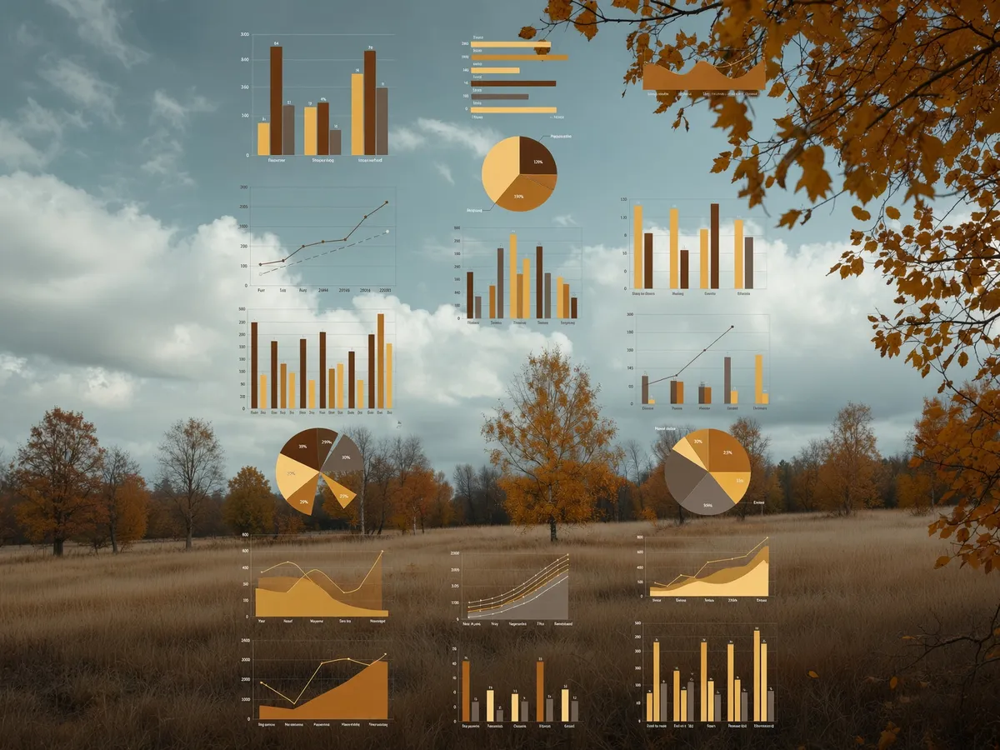

Recently Stack Overflow released the results of their [annual developer survey](https://survey.stackoverflow.co/2026). Today we'll go through it and possibly some others too:

* [2026 Ruby on Rails Community Survey](https://railsdeveloper.com/survey/2026)
* JetBrains [The State of CI/CD in 2026](https://www.jetbrains.com/pages/state-of-cicd2026/)
* [SAP Developer Insights Survey 2026](https://community.sap.com/t5/technology-blog-posts-by-sap/the-2026-developer-insights-survey-the-report/ba-p/14391535)
* And even more surveys by [Devographics](https://devographics.com/)
    * [2026 State of Web Dev AI](https://2026.stateofai.dev/en-US)
    * [2026 State of Devs Survey](https://2026.stateofdevs.com/en-US)
    * [2026 State of CSS Survey](https://2026.stateofcss.com/en-US)

Everyone is welcome to [join](https://weeklydevchat.com/join/) as long as you are kind, supportive, and respectful of others. The Zoom link will be posted at 12 p.m. MDT.

