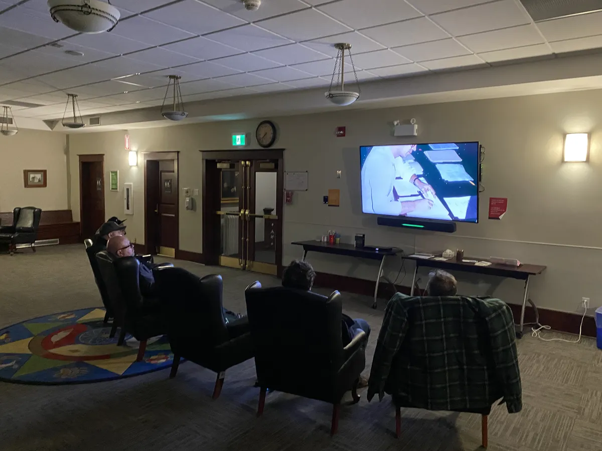

Thanks to everyone who braved rain/sleet/snow and joined us for the [General Magic](https://www.generalmagicthemovie.com/) Watch Party last night (Oct 27th).  It was great to watch and discuss the documentary with fellow developers.

What was your takeaway from the documentary?  For me it was don't try to implement everything at once.  That is very risky.  Start with a solid base product that does one thing well and gradually add to it.

Special thanks to the [Edmonton Public Library](https://www.epl.ca/) - [Strathcona](https://www.epl.ca/locations/eplstr/) for providing the comfy chairs and the new TV.

See you at our next in-real-life (IRL) event in November, date to be decided, or online every Tuesday at 12pm Alberta Time.

.