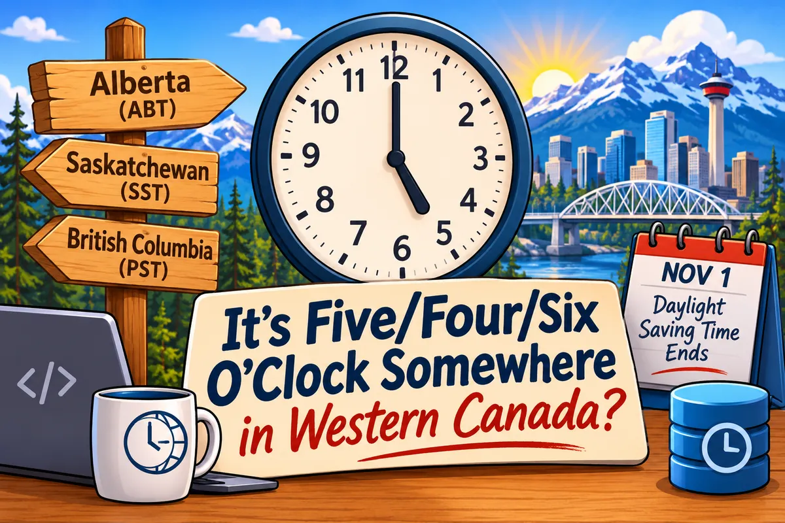

The initial topic for today's (Nov 3, 2026) chat: What time is it?  A simple question that was complicated in Alberta and other western Canadian provinces this week as they stopped observing daylight saving time last weekend (Nov 1st).

I've spent the last couple days double checking the time on my operating systems and various calendars.  Not all providers have added the new [Alberta Time (ABT)](https://www.alberta.ca/albertas-new-time-system-abt) time zone yet, or if they did I needed to manually set it, move existing events, etc.  I also have an older Synology NAS that I don't think will ever get the new time zone.

Let's chat about time, time zones, and how you deal with it in software and databases.  We can also chat about how you would "fix time" if you were supreme ruler of Earth.

Everyone and anyone is welcome to [join](https://weeklydevchat.com/join/) as long as you are kind, supportive, and respectful of others.

