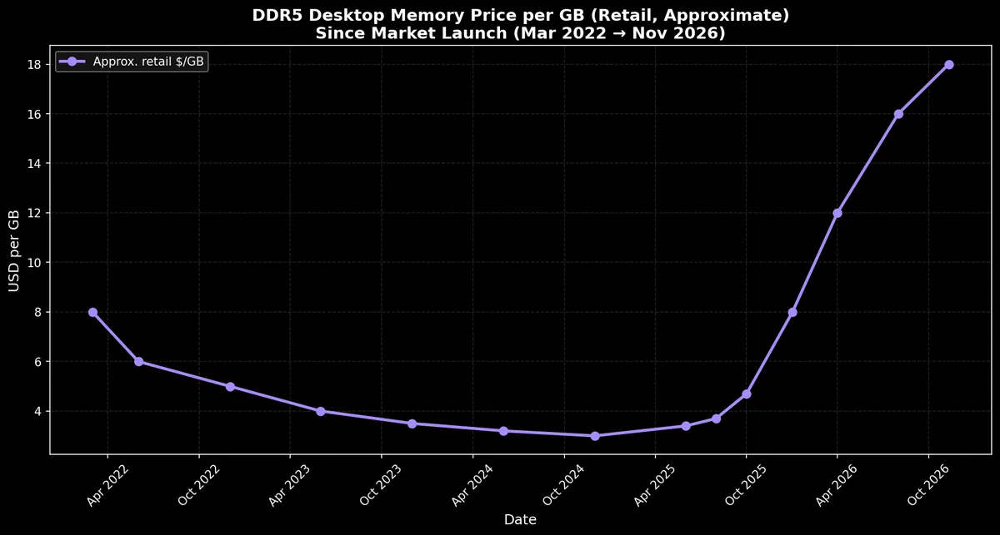

Last week Discord announced they were dropping Electron (the Chromium-based framework) in favour of a native Rust rewrite. They claim it drops memory usage to 290 MB.

This would be impressive if it pans out. On my machine, at the moment, I see 842.4 MB being used by Discord.

What's your opinion of Electron? It's been the foundation of many apps I use daily (Slack, VS Code, Discord). Is it worth the price paid in memory (which isn't cheap!)? Is Discord going to lead a trend? If starting a new project, what framework would you use?

Everyone is welcome to [join](https://weeklydevchat.com/join/) as long as you are kind, supportive, and respectful of others. Proton Meet link will be posted at 12 pm Alberta Time aka Central Standard Time (ABT/CST/UTC-6).

