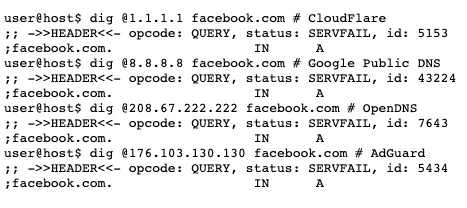

This week Microsoft 365 went down worldwide, and a day later the FAA grounded every departing flight in the US. Neither was a cyberattack. Both came down to systems getting overwhelmed.

This week we're talking about building for failure: outage war stories, graceful degradation, testing for failure before it happens, and whether local/open-source AI models are a real hedge against cloud dependence.

Everyone and anyone is welcome to [join](https://weeklydevchat.com/join/) as long as you are kind, supportive, and respectful of others. Proton Meet link will be posted at 12 pm Alberta Time aka Central Standard Time (ABT/CST/UTC-6).

